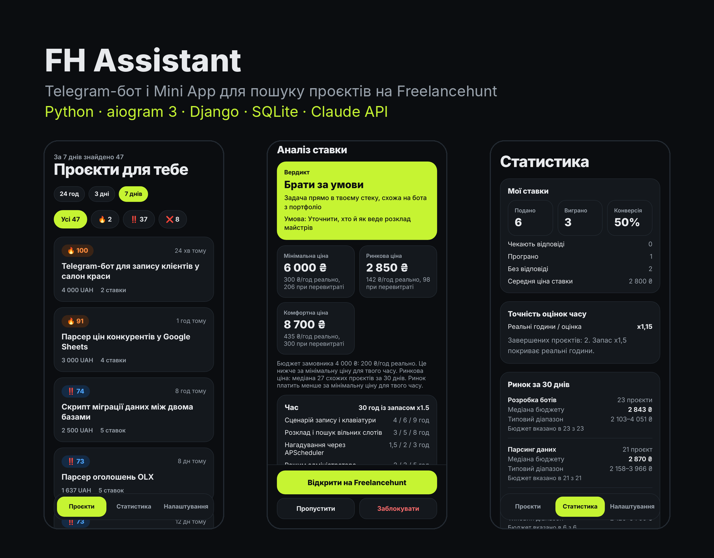
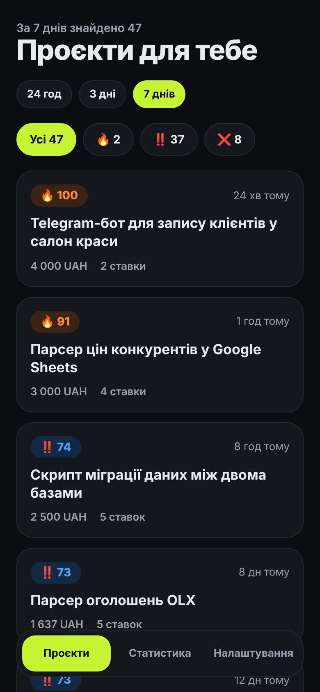
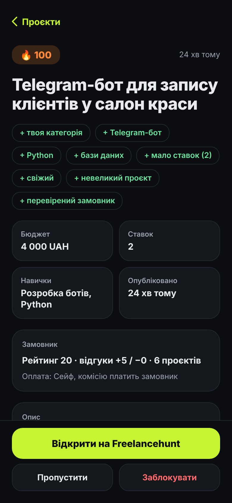
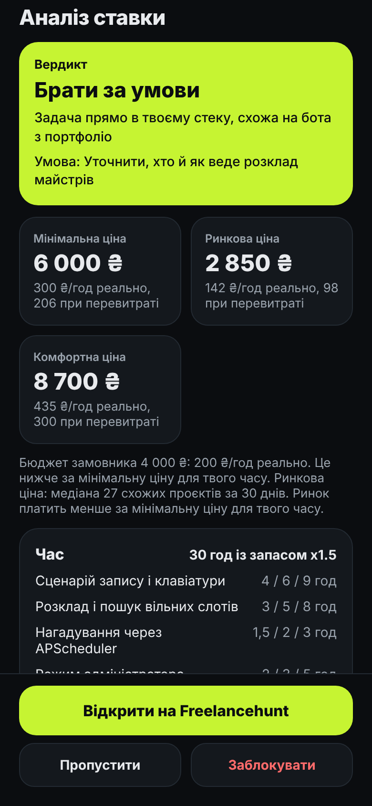
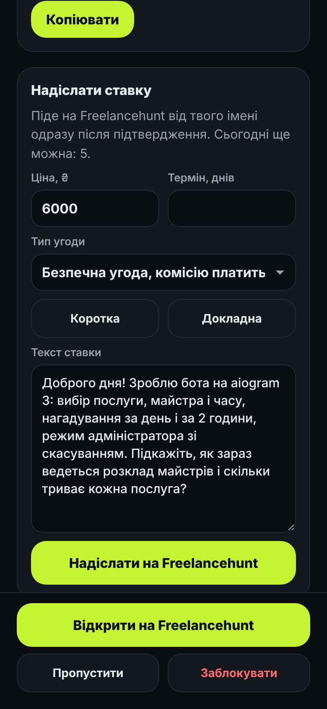
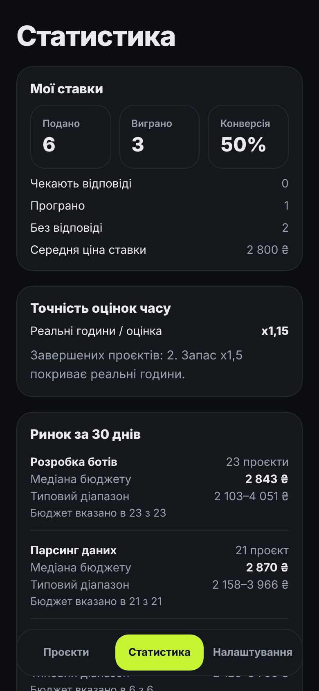

# FH Assistant

A personal Telegram bot for freelancers on [Freelancehunt](https://freelancehunt.com). Every 7 minutes it pulls new projects from the API, filters out the noise, scores the rest from 0 to 100 and sends them to Telegram. For a chosen project, Claude estimates the hours and price and writes two reply drafts. A bid can be submitted from the Mini App with one button after confirmation.



## Screenshots

The interface is in Ukrainian. All screenshots use demo data.

| Project feed | Project card | Bid analysis |
|---|---|---|
|  |  |  |

| Bid submission | Statistics |
|---|---|
|  |  |

## Features

- **Monitoring.** Polls `/v2/projects`, catches up on missed pages after a restart, deduplicates in SQLite and backs off with a growing pause on HTTP 429.
- **Filters.** Skills, minimum budget in UAH (other currencies converted at the National Bank of Ukraine rate), stop words, a client blacklist, quiet hours and pause. Similar projects from other categories also reach the feed, with a label.
- **Scoring.** Transparent rules: stack match, number of bids, freshness, client history and red flags such as "free test task", contacts outside the platform or a thin description. Markers 🔥 ‼️ ❌; weak projects arrive without sound.
- **Bid analysis.** Claude Haiku returns a structured answer through tool use: what needs to be done, hours per subtask, risks, questions for the client, a verdict and two drafts. The price is calculated in code: hours × buffer × minimum hourly rate, plus the 30-day market median. The project text is marked as untrusted data in the prompt.
- **Bid submission.** A Mini App form sends `POST /v2/projects/{id}/bids`. Before sending, it checks the text for contacts and amounts (both banned by the platform rules), asks for confirmation and enforces a daily limit.
- **Bid log and statistics.** Bid statuses, conversion, accuracy of time estimates, median budgets per skill and the hours when matching projects appear.
- **Heartbeat.** A Telegram alert when Freelancehunt rejects the token or polling has failed for 2 hours. A ping to healthchecks.io after every successful poll catches a full server outage.

## Stack

Python 3.12, aiogram 3, APScheduler, aiohttp, aiosqlite, pydantic-settings, Anthropic SDK. Mini App: Django 5.2 on the same database (unmanaged models, WAL), gunicorn, whitenoise, no JS frameworks. Hosting: Google Cloud e2-micro (free tier), systemd, Tailscale Funnel for HTTPS without a domain.

## Project layout

```
app/            bot: polling, filters, scoring, analysis, notifications, commands
  poller.py     polling loop and catch-up
  scoring.py    scoring rules (term lists in scoring_rules.py)
  analysis.py   prompt and schema for Claude
  pricing.py    price calculation
  health.py     failure alerts and healthchecks.io
web/            Django Mini App (dashboard/: views, templates, static)
tests/          pytest, no network and no real Claude calls
deploy/         systemd units
docs/           screenshots
profile.yaml    experience and skills used in bid analysis
```

## Installation

```bash
git clone <repo> fh-assistant && cd fh-assistant
python3 -m venv .venv
.venv/bin/pip install -r requirements.txt
cp .env.example .env    # fill in the variables below
.venv/bin/python -m app
```

On Windows, use `.venv\Scripts\` instead of `.venv/bin/`.

| Variable | Description |
|---|---|
| `FH_TOKEN` | API token from your Freelancehunt profile settings |
| `BOT_TOKEN` | bot token from @BotFather |
| `ALLOWED_USER_ID` | your Telegram ID; the bot answers only you |
| `ANTHROPIC_API_KEY` | Claude API key; without it, analysis is disabled |
| `MINIAPP_URL` | HTTPS address of the Mini App; without it, Mini App buttons are hidden |
| `HEALTHCHECK_URL` | Ping URL from healthchecks.io, optional |

Other settings (skills, minimum hourly rate, time buffer, limits) live in `app/config.py` and can also be overridden in `.env`. The budget threshold, stop words and quiet hours are changed with bot commands or in the Mini App.

## Server

```bash
sudo cp deploy/fh-bot.service deploy/fh-web.service /etc/systemd/system/
sudo sed -i "s/USER/$USER/g" /etc/systemd/system/fh-*.service
.venv/bin/python web/manage.py collectstatic --noinput
sudo systemctl daemon-reload
sudo systemctl enable --now fh-bot fh-web
sudo tailscale funnel --bg 8000
```

Put the address from `tailscale funnel status` into `MINIAPP_URL` and restart `fh-bot`. The bot sets the "Проєкти" menu button itself.

To update: `git pull`, then `collectstatic` and `sudo systemctl restart fh-bot fh-web`. Logs: `journalctl -u fh-bot -f` and `logs/bot.log`.

## Tests

```bash
.venv/bin/pip install -r requirements-dev.txt
.venv/bin/python -m pytest
```

The 52 tests cover parsing of recorded API responses, filters, scoring, deduplication and catch-up, pricing and statistics, bid text checks, the heartbeat and the main Mini App pages. The network and Claude are mocked.

## Limitations

- The bot serves a single user.
- Bids are submitted manually only, one at a time, after confirmation. Rule 3.1.11 of the Freelancehunt terms forbids tools for automatic bid placement, so there is no bulk or automatic submission.
- The public contests list in the API currently returns 404, so the bot does not track contests.

## License

The code is published for viewing only. Copying, modifying or using it without the author's permission is not allowed; see `LICENSE`.
